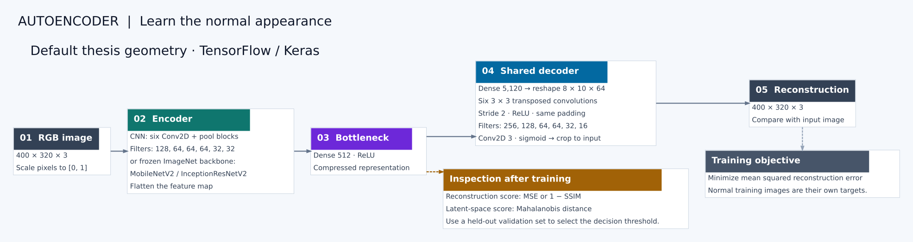
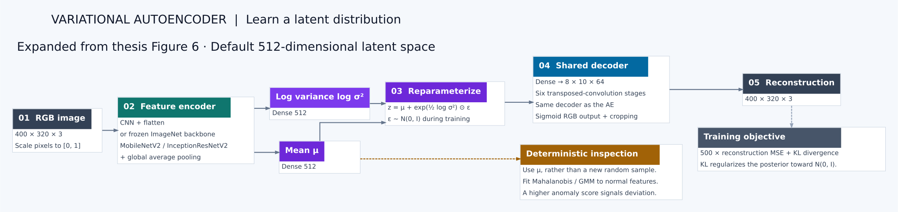
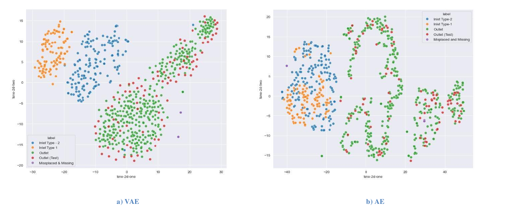

# Visual Anomaly Detection for Factory Quality Control

**Autoencoders, variational autoencoders and transfer learning for visual assembly inspection.** This repository accompanies my 2024 master's thesis at the **University of Skövde**, conducted in collaboration with **Aurobay**. It investigates learning normal engine-valve and spring assemblies when examples of assembly errors are scarce.

The completed thesis experiments compare convolutional **AEs and VAEs**, including **MobileNetV2** and **InceptionResNetV2** encoder variants. GAN-based anomaly detection is covered in the literature review and exploratory notebooks.

**TensorFlow / Keras · Computer vision · Anomaly detection · Representation learning**

[Thesis: permanent record](https://urn.kb.se/resolve?urn=urn:nbn:se:his:diva-24446) · [Read the full thesis](https://his.diva-portal.org/smash/get/diva2:1891576/FULLTEXT01.pdf) · [Original notebooks](docs/notebook-index.md) · [Setup](docs/setup.md) · [Reported results](docs/thesis-results.md)

## Problem: imbalanced inspection data

Correct assemblies were much more common than faulty ones. Missing or misplaced valves and springs were rare, and deliberately creating enough fault examples would interrupt production and require rework. This left too few representative fault images for a balanced, supervised classification dataset.

That imbalance motivated the **AE/VAE anomaly-detection approach**: learn the appearance or latent distribution of a chosen normal assembly class, then score deviations from it. Normal-only training reduces dependence on a large, balanced collection of examples for every possible fault. Representative normal data and a separate evaluation set are still needed.

## Research approach

Train an encoder-decoder on normal images, then inspect either reconstruction differences or the distribution of latent representations. A selected component class is the inlier class; other component classes and assembly-error examples form the anomaly cases.

| Component | What the project investigates |
| --- | --- |
| Convolutional AE | Learn a compact representation and reconstruct the input |
| Transfer-learning AE | Use a frozen ImageNet encoder with the same decoder |
| VAE | Learn posterior mean/variance with reconstruction and KL objectives |
| Reconstruction scoring | MSE and structural similarity (SSIM) |
| Latent scoring | Mahalanobis distance, GMM, and additional notebook experiments |
| GAN-related work | Literature review and experimental TensorFlow/anomalib notebooks |

The research configuration uses **400 × 320 RGB images** and a **512-dimensional latent space**. The main comparison concerns normal assembly/type verification on an imbalanced industrial dataset, including a small number of missing or misplaced components.

## Autoencoder architecture

[](docs/assets/ae-architecture.svg)

*Redrawn from the implementation and thesis Figure 5. The baseline uses six convolution/pooling stages; encoder alternatives retain the decoder. Open the diagram for full resolution.*

## Variational autoencoder architecture

[](docs/assets/vae-architecture.svg)

*Expanded from thesis Figure 6: posterior heads, reparameterization, reconstruction and latent scoring. The portable adapter uses posterior means for deterministic inspection.*

## Selected thesis results

| Normal class | Model / anomaly score | ROC-AUC | PR-AUC | Best F1 |
| --- | --- | ---: | ---: | ---: |
| Outlet | CNN AE / MSE | 0.98563 | 0.98998 | 0.97938 |
| Outlet | MobileNetV2 AE / SSIM | 0.99696 | 0.99731 | 0.97938 |
| Outlet | InceptionResNetV2 VAE / Mahalanobis | 1.00000 | 1.00000 | 1.00000 |
| Inlet type 2 | InceptionResNetV2 VAE / GMM | 0.99644 | 0.99844 | 0.98069 |

These are selected **historical thesis results**, from Tables 2, 5 and 6, rather than newly reproduced measurements. Anomalies include other component classes; best F1 was chosen through threshold sweeps. The scores do not establish general production defect-detection accuracy. See [result context and source pages](docs/thesis-results.md).

For the complete tables, timing comparison, precision–recall curves and score-distribution boxplots, use the [results page guide](docs/thesis-results.md#where-to-find-all-results), or open the [full results chapter, printed pp. 38–47](https://his.diva-portal.org/smash/get/diva2:1891576/FULLTEXT01.pdf#page=39).

[](docs/assets/thesis-convergence-or-latent.png)

*Published thesis Figure 8: a t-SNE visualization of VAE and AE representations. It illustrates the recorded experiment; t-SNE separation alone is not a quantitative performance guarantee.*

## Run the portable implementation

The Python package provides reusable AE/VAE model builders, training and held-out evaluation. It is a modernized reference adapter derived from the notebooks. The historical notebooks are catalogued separately and retain unfinished experiments.

Tested with Python 3.12, **TensorFlow CPU 2.16.2**, **Keras 3.15.1** and scikit-learn 1.5.2. Python 3.10–3.12 is declared; the recorded local checks used Linux CPU.

```bash
python -m venv .venv
source .venv/bin/activate
python -m pip install -e .

factory-anomaly train \
  --data-root /path/to/your/images \
  --output artifacts/vae-cnn \
  --model vae --epochs 50

factory-anomaly evaluate \
  --data-root /path/to/your/images \
  --run artifacts/vae-cnn --method mahalanobis
```

Use `--model ae` for the ordinary autoencoder. Reconstruction scoring supports `--method mse` or `ssim`; latent scoring supports `mahalanobis` or `gmm`. For transfer learning, explicitly select, for example, `--backbone mobilenetv2 --weights imagenet`; this downloads ImageNet weights. The default CNN is trained from scratch and performs no weight download.

### Data ownership and your own classes

The industrial images used in this research **belong to Aurobay** and were provided under a confidentiality agreement. They are excluded from this repository, along with embedded notebook image previews and trained checkpoints. The result charts shown here come from the publicly available thesis and are attributed to it.

You can use **your own image classes**. Choose what counts as normal for your application, place those images in the normal splits, and use your fault or other-class images for held-out anomaly evaluation. The portable code uses `normal` and `anomaly` as folder roles; it does not depend on Aurobay's valve-class names.

For example, correctly assembled parts can be your normal class, with missing-component and wrong-orientation images in subfolders under `test/anomaly/`. Use this layout:

```text
images/
├── train/normal/          # Fit model and normal latent distribution
├── validation/normal/     # Monitor training loss
├── calibration/normal/    # Set threshold without test labels
└── test/
    ├── normal/
    └── anomaly/           # Held-out evaluation only
```

The adapter normalizes RGB inputs to `[0, 1]`, resizes all splits consistently, and makes larger scores mean more anomalous. Its thresholds use a normal calibration split instead of choosing a threshold on the evaluated anomalies. These changes improve reuse; they do not reproduce the original evaluation protocol. See [implementation differences](docs/implementation-notes.md).

## Repository contents

```text
src/factory_anomaly/       Portable TensorFlow models, data loading, scoring and CLI
notebooks/                Sanitized historical AE, VAE and exploratory notebooks
docs/                     Setup, notebook catalogue, results and redrawn diagrams
tests/                    Synthetic model, serialization and workflow checks
tools/                    Reproducible notebook preparation
```

Notebook outputs and attachments are removed because they contain industrial image previews, local paths and stale interactive results. Source-file provenance is recorded in [the notebook manifest](notebooks/source-manifest.json). No full notebook execution or industrial-data benchmark is claimed during repository preparation.

## Thesis

**Artificial Intelligence for Factory Automation – Anomaly Detection for Quality Control**

Adhithya Palanisamy Chandrasekaran · University of Skövde · 2024

Master's degree project in Virtual Product Realization, 30 ECTS.

[Permanent record](https://urn.kb.se/resolve?urn=urn:nbn:se:his:diva-24446) · [DiVA entry](https://his.diva-portal.org/smash/record.jsf?pid=diva2:1891576) · [Full text](https://his.diva-portal.org/smash/get/diva2:1891576/FULLTEXT01.pdf)

Developed by **[Adhithya Palanisamy Chandrasekaran](https://github.com/ADHU-ADHU)**. TensorFlow, Keras and pretrained application models are third-party tools; experimental upstream references are documented in [THIRD_PARTY.md](THIRD_PARTY.md).
