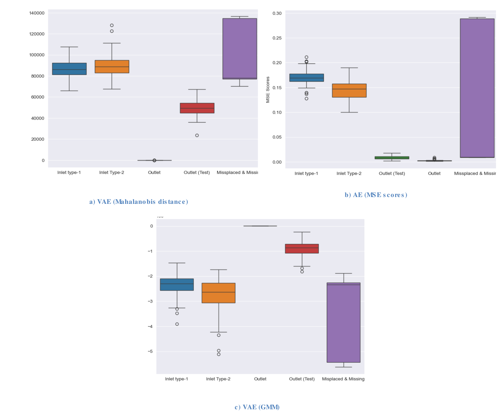

# Thesis results and research context

The original research is documented in **Artificial Intelligence for Factory Automation – Anomaly Detection for Quality Control**, Adhithya Palanisamy Chandrasekaran, University of Skövde, 2024. The work formed a 30 ECTS master's thesis in Virtual Product Realization, carried out in collaboration with Aurobay.

[Permanent thesis record](https://urn.kb.se/resolve?urn=urn:nbn:se:his:diva-24446) · [Published full text](https://his.diva-portal.org/smash/get/diva2:1891576/FULLTEXT01.pdf)

## Research question

The motivating problem was **class imbalance**: correctly assembled examples were common, while faulty assemblies were scarce. Deliberately creating missing/misplaced-component cases would disrupt production and require rework. Learning a normal class with an AE or VAE offered a way to score unusual assemblies without requiring a balanced set of labeled examples for each fault class. This motivation is described in section 1.1, printed pp. 9–10 of the thesis.

Can models trained on normal valve and spring assembly images identify unexpected assemblies when fault examples are scarce? The study compared convolutional autoencoders (AEs) and variational autoencoders (VAEs), using either a custom CNN encoder or ImageNet features from MobileNetV2 and InceptionResNetV2. The decoder was kept consistent to study the effect of the encoder and anomaly score.

The principal experiments used RGB images of 400 × 320 pixels and a 512-dimensional latent representation. AE training minimized reconstruction MSE. VAE training combined a reconstruction term with KL divergence. Experiments included reconstruction scores, Mahalanobis distance, Gaussian mixture models (GMM), kernel density estimation and one-class SVM. GAN-based approaches were reviewed and explored in additional notebooks; they were not part of the thesis's main quantitative comparison.

## Where to find all results

The repository shows selected results and published charts. The complete discussion and tables remain in the [full thesis results chapter, printed pp. 38–47](https://his.diva-portal.org/smash/get/diva2:1891576/FULLTEXT01.pdf#page=39).

| Material | Printed thesis page(s) | Open in the PDF |
| --- | --- | --- |
| AE experiments, reconstruction metrics and timing | 38–41 | [AE results](https://his.diva-portal.org/smash/get/diva2:1891576/FULLTEXT01.pdf#page=39) |
| Training and inference timing comparison, Table 4 | 41 | [Timing table](https://his.diva-portal.org/smash/get/diva2:1891576/FULLTEXT01.pdf#page=42) |
| VAE analysis and latent-space scoring | 41–47 | [VAE results](https://his.diva-portal.org/smash/get/diva2:1891576/FULLTEXT01.pdf#page=42) |
| t-SNE and precision–recall comparisons, Figures 8–9 | 43 | [Latent and PR figures](https://his.diva-portal.org/smash/get/diva2:1891576/FULLTEXT01.pdf#page=44) |
| Score-distribution boxplots, Figure 10 | 44 | [Boxplots](https://his.diva-portal.org/smash/get/diva2:1891576/FULLTEXT01.pdf#page=45) |
| Detailed VAE metric tables, Tables 5–6 | 44–47 | [VAE tables](https://his.diva-portal.org/smash/get/diva2:1891576/FULLTEXT01.pdf#page=45) |

The links use PDF viewer page numbers, which are one greater than the printed page labels. The thesis's published figures can be viewed in context through these links; private source images and notebook previews are not redistributed.

## Selected historical configurations

**These numbers are reported in the 2024 thesis. They have not been reproduced by running this repository.** All rows below used 50 epochs. They are selected examples of the published evaluation, rather than a complete leaderboard.

| Normal training class | Model | Anomaly score | ROC-AUC | PR-AUC | Best F1 | Thesis source |
|---|---|---|---:|---:|---:|---|
| Outlet | CNN AE | MSE | 0.98563 | 0.98998 | 0.97938 | Table 2, p. 39 |
| Outlet | InceptionResNetV2 AE | SSIM | 0.99573 | 0.99640 | 0.97938 | Table 2, p. 39 |
| Outlet | MobileNetV2 AE | SSIM | 0.99696 | 0.99731 | 0.97938 | Table 2, p. 39 |
| Outlet | InceptionResNetV2 VAE | Mahalanobis | 1.00000 | 1.00000 | 1.00000 | Table 5, p. 44 |
| Outlet | InceptionResNetV2 VAE | GMM | 0.99966 | 0.99969 | 0.99000 | Table 5, p. 44 |
| Inlet Type-2 | CNN AE | MSE | 0.99947 | 0.99976 | 0.99620 | Table 3, p. 40 |
| Inlet Type-2 | InceptionResNetV2 VAE | GMM | 0.99644 | 0.99844 | 0.98069 | Table 6, p. 46 |
| Inlet Type-2 | CNN VAE | Mahalanobis | 0.99988 | 0.99994 | 0.99620 | Table 6, p. 47 |

Page references use the thesis's printed page numbers; the PDF viewer page is one greater. Values are transcribed as published, with trailing zeros added only for consistent display. **Best F1** is the best score across decision thresholds, rather than performance at a separately validated deployment threshold. ROC-AUC and PR-AUC measure ranking across thresholds; they are not percentages of correct predictions.

Results depend on the normal class and scoring method. The pretrained VAE with Mahalanobis distance achieved perfect separation in the reported outlet experiment, while custom CNN models were also strong on the inlet Type-2 task. These results do not establish a universal winning architecture.

## Published latent-space comparison

**Source:** Figure 8, printed p. 43 of the [published thesis](https://his.diva-portal.org/smash/get/diva2:1891576/FULLTEXT01.pdf#page=44). Left: VAE; right: AE. Both use InceptionResNetV2 encoders and outlet-valve training images. This is a crop of the publicly published chart, not a new model run. The t-SNE axes are a visualization of latent features; distances between projected clusters do not independently validate detection performance.

## Published score-distribution boxplots

**Source:** Figure 10, printed p. 44 of the [published thesis](https://his.diva-portal.org/smash/get/diva2:1891576/FULLTEXT01.pdf#page=45). Panels show **(a) VAE Mahalanobis distance**, **(b) AE reconstruction MSE**, and **(c) VAE GMM scores**, with InceptionResNetV2 encoders trained on the outlet class. This is the original published chart, not a newly computed result or a raw industrial image. Score scales and category ordering differ between panels; compare class distributions within each panel rather than absolute heights across methods.

## Reading the results in context

- **Small industrial dataset:** Table 1, p. 32 reports 459 outlet images, 138 inlet Type-1 images, 211 inlet Type-2 images and only 7 misplaced/missing examples. The study states an 80:20 training/testing split. Individual archived notebooks contain evolving experiments and should not be assumed to reproduce that exact split automatically.
- **One-class assembly verification:** a model trained on one normal valve type treated other valve types as anomalous too. The evaluation therefore includes valve-type differences as well as misplaced or missing components. It does not establish performance on minute surface defects or arbitrary manufacturing faults.
- **Threshold sensitivity:** changing reconstruction or latent-space scores substantially changed results. Thresholds for a new dataset should be selected using a dedicated validation set, then evaluated once on held-out test data.
- **Limited tuning:** the thesis discusses limited normal data, overfitting, decoder cropping, latent-size and learning-rate choices, VAE loss balancing, and untuned GMM/KDE parameters (section 5.3, p. 47).
- **Research archive and maintained adapter:** the portable TensorFlow package preserves the default architecture geometry while making data paths and configuration explicit. Its deterministic VAE inspection uses the posterior mean. Historical notebooks also explored log-variance features and other scoring choices. Changing that representation can change results.
- **Data access and ownership:** the industrial images belong to Aurobay and were provided under a confidentiality agreement, as described in section 7.2, p. 51. Raw images, embedded notebook outputs and trained weights are excluded from this repository. Published result charts are attributed to the publicly available thesis. The portable code can be used with your own normal and anomaly classes; see [data preparation](setup.md#prepare-data).

## Architecture drawings

The repository's [AE diagram](assets/ae-architecture.svg) and [VAE diagram](assets/vae-architecture.svg) redraw and expand the ideas in thesis Figures 5 and 6. Layer sequences follow the supplied code and maintained implementation where diagram labels or prose differ. The VAE diagram also shows the modern adapter's training objective and deterministic scoring path; it should not be read as a pixel-for-pixel replacement for the original figure.
